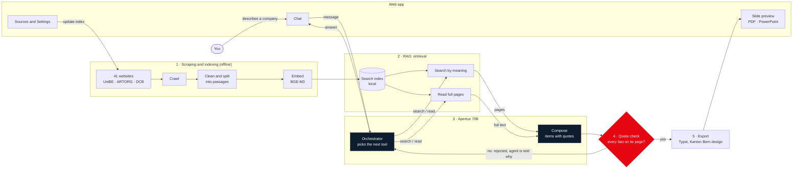

# RAGlette

**Raclette + RAG.** RAGlette is a Research & Expertise Navigator for Bern. It was built at Hack Apertus by the team *Mylife with Tokens* (Daniele, Han, Marc) for the challenge of the Bern Economic Development Agency.

You describe a company or a need in the chat, in your own words. An agent running on **Apertus 70B**, the open Swiss language model, then does the following:

1. It searches the indexed websites of Bern's research institutions: the University of Bern with its faculties and institutes, ARTORG, and the Diabetes Center Berne.
2. It reads the best pages in full.
3. It collects the matching research groups, infrastructure, programmes, networks and contacts.

Every item is checked against its source page. The result appears as slides in the Kanton Bern design, right next to the chat, and can be downloaded as PDF or PowerPoint. You stay in charge: ask for more, drop items, change a text, all in the chat.

## Contents

- [RAGlette](#raglette)
  - [Contents](#contents)
  - [The problem](#the-problem)
  - [How it works](#how-it-works)
    - [1. Scraping and indexing (offline, no language model)](#1-scraping-and-indexing-offline-no-language-model)
    - [2. RAG: retrieval between the index and Apertus](#2-rag-retrieval-between-the-index-and-apertus)
    - [3. Apertus 70B: orchestrator and composer](#3-apertus-70b-orchestrator-and-composer)
    - [4. Quote check (plain code, `rag_model/brief.py`)](#4-quote-check-plain-code-rag_modelbriefpy)
    - [5. Export (`rag_model/presentation.py`, `presentation/template/`)](#5-export-rag_modelpresentationpy-presentationtemplate)
  - [Using the app](#using-the-app)
  - [Installation and start](#installation-and-start)
    - [1. Get the code and the data](#1-get-the-code-and-the-data)
    - [2. Install and run](#2-install-and-run)
    - [3. Connect Apertus](#3-connect-apertus)
  - [Configuration](#configuration)
  - [Updating the search index](#updating-the-search-index)
    - [From the UI](#from-the-ui)
    - [By hand](#by-hand)
  - [Project layout](#project-layout)
  - [API](#api)
  - [Development](#development)
  - [Limitations](#limitations)
  - [Outlook: a fine-tuned Apertus 8B](#outlook-a-fine-tuned-apertus-8b)

## The problem

Bern's research expertise is public, but it is scattered. It sits on faculty, institute, research-group, centre, researcher and project pages, across dozens of websites in three languages, each built differently.

To find it, you need to know *where* to look before you know *what* to look for. The words also differ. Someone looking for "glucose sensors" misses pages that say continuous glucose monitoring, biosensor, Glukosesensor or wearable sensing. In our index, 22 pages contain "glucose sensor", and 83 more pages on 8 websites use one of those other terms.

RAGlette puts all these sources behind one conversation. It searches by meaning, not by exact words, and it backs every answer with its source.

## How it works



*How to read it:* you only talk to the chat. Every message goes to Apertus 70B, which decides what to do next: it searches the local index, reads the most promising pages in full and writes items from them. Plain code checks every item against its source page before it becomes a slide. The index itself is built beforehand, without a language model, from the websites listed under Sources. Dark boxes are Apertus, the red one is plain code.

### 1. Scraping and indexing (offline, no language model)

- **Crawl** (`scraper/`): fetches the public pages of the websites in `sources.yaml`. It uses sitemaps where they exist, sends one request per second per website, and respects robots.txt. The result goes to `data/crawl.sqlite`.
- **Clean and split** (`indexing/`):
  - removes menus and footers, meaning lines that repeat across many pages of a website;
  - removes duplicates and pages with almost no text;
  - splits the pages into passages of about 100–200 words with overlap.
- **Embed:** every passage becomes a BGE-M3 vector. The website and page title go in as context.
- **Store:** pages, passages and vectors go into `data/index.sqlite`, and the vectors also into a local Qdrant store in `data/qdrant`. Everything runs locally; there is no external search service.

There are no rules per website. Adding a website means adding one start URL on the Sources page.

### 2. RAG: retrieval between the index and Apertus

- **Search:**
  - Apertus, the agent, first writes short hypothetical passages that a matching page might contain (HyDE), in the words a website would use. That is how "glucose sensors" also finds "continuous glucose monitoring".
  - Each passage is embedded with BGE-M3 and searched in the vector store, by meaning. The results of all passages are grouped per page and merged with RRF (reciprocal rank fusion), with near-duplicate pages (such as language variants) dropped and a limit of pages per website.
- **Read pages:** the agent reads the most promising pages in full, not just the passages that matched.

### 3. Apertus 70B: orchestrator and composer

The chat agent (`rag_model/agent.py`) is a tool-calling loop on Apertus 70B. Every message goes to it, together with the current list of items. It decides which tool to run next:

| Tool | What it does |
|---|---|
| `search` | HyDE passages → vector search → candidate pages |
| `read_pages` | the full text of chosen pages |
| `add_items` | adds partners (research, infrastructure, programme, network, education), each with organisation, relevance, up to 3 facts, contacts and a verbatim quote |
| `remove_items` / `restore_items` | moves items to the trash and back |
| `edit_item` | changes an item on request; it is then marked as changed and no longer backed by a quote |
| `update_presentation` | title slide, subtitle, overview and contacts slides |

Every tool result goes back to Apertus, which calls the next tool or answers in the chat. The loop has guards:

- a step limit per message;
- repeated identical calls are skipped;
- reminders when it stops halfway;
- recovery of tool calls that the model writes as text.

A **Stop** button ends a run at any time.

### 4. Quote check (plain code, `rag_model/brief.py`)

Before an item reaches a slide:

- its quote must appear on the cited page (fuzzy match, at least 90 % by default);
- each fact must be found on that page in the same way;
- a contact's name must appear on the page, and email addresses and phone numbers are checked too.

Facts that fail the check are dropped. Items without a valid quote are rejected and the agent is told why.

### 5. Export (`rag_model/presentation.py`, `presentation/template/`)

The checked items are rendered with **Typst** using the team's Kanton Bern template. The deck has:

- a title slide;
- an "At a glance" overview;
- one slide per item;
- a contacts slide.

The preview next to the chat updates live. Export gives a PDF, or a PowerPoint with every slide as a picture and its text in the speaker notes.

## Using the app

- **Chat.** Start with the company: "Start-up developing wearable glucose sensors". The steps the agent takes are listed as it works (Searched, Read pages, Added items …), and the slide panel slides in once the first items exist. Then refine in the chat: "focus on research groups", "find more on rehabilitation", "drop the funding programmes", "shorten the texts". Conversations are saved and can be reopened or deleted from the menu at the top.
- **Slides panel.** The **Slides** tab shows the preview: a big view with arrow keys, **F** for fullscreen, deleting and hiding slides, editing the title slide, and **Export** (PDF, PowerPoint) at the bottom right. The **Evidence** tab shows the quote and source page of every item.
- **Sources.** The list of websites, each one only a start URL. You can switch a website off, edit or remove it, and add new ones.
- **Settings.**
  - **API access:** gateway URL, key and model.
  - **Search index:** status and the update button with a progress bar.
  - **Parameters:** grouped into Agent, Slides, Search, Evidence check, Apertus calls and Index preparation, each with an explanation.

## Installation and start

**Requirements:** Python 3.14 with [uv](https://docs.astral.sh/uv/), Node.js, about 3 GB of disk space for the embedding model, and an Apertus API key for an OpenAI-compatible gateway.

### 1. Get the code and the data

The search index is too large for git. Download it from the release [raglette-data-v1](https://github.com/Najahiri/mylife-with-tokens/releases/tag/raglette-data-v1) and unzip it into `data/`:

```sh
mkdir -p data && cd data
curl -LO https://github.com/Najahiri/mylife-with-tokens/releases/download/raglette-data-v1/index.sqlite.zip
unzip index.sqlite.zip && rm index.sqlite.zip && cd ..
```

`index.sqlite` holds the pages, the passages and their BGE-M3 vectors. On the first start the API builds the vector store `data/qdrant` from it, which takes about a minute. It also downloads BGE-M3 (about 2 GB) from Hugging Face. `crawl.sqlite.zip` in the same release is the raw crawl; you only need it to rebuild the index without crawling again.

### 2. Install and run

```sh
uv sync
cd frontend && npm install && npm run build && cd ..
uv run uvicorn api.main:app --port 8000     # http://localhost:8000
```

### 3. Connect Apertus

Under **Settings → API access**, enter the gateway base URL, the API key and the model. Use `apertus-v1-5-70b`, which handles the tool calls reliably; the 8B works, but worse. **Test connection** checks that the model answers.

The key is stored only in `data/settings.json` (file mode 600, not in git). It is never sent to the browser. Alternatively, set the environment variables `APERTUS_BASE_URL`, `APERTUS_API_KEY` and `APERTUS_MODEL_AGENT`.

## Configuration

- **`config.yaml`** holds the defaults of every parameter.
- **Settings in the UI:** changes there are saved to `data/config_overrides.json` and take effect with the next message. A reset per group restores the defaults.
- **`sources.yaml`** is the list of websites, edited on the Sources page.
- **`prompts/agent.yaml`** holds the agent's system rules and tool descriptions. **`prompts/brief.yaml`** holds the item schema.

Important defaults:

| Parameter | Default | Meaning |
|---|---|---|
| `agent.max_steps` | 15 | model calls per chat message |
| `brief.max_items` | 15 | item slides at most |
| `brief.language` | English | language of the slides |
| `search.top_n` / `max_per_site` | 30 / 8 | pages per search, pages per website |
| `check.evidence_min_ratio` | 90 | how closely a quote must match its page (%) |
| `llm.max_tokens` / `timeout` | 6000 / 300 s | limits per Apertus call |

## Updating the search index

### From the UI

Use **Settings → Search index → Update index**. The update runs while the chat keeps working on the current index:

1. **Crawl** new pages. With *Re-fetch all pages* switched on, every page is fetched again, which takes hours.
2. **Clean and split** all pages.
3. **Embed** only new or changed passages. Unchanged ones keep their vectors.
4. **Build** the vector store next to the live one.
5. **Switch** the API to the new index without a restart. The previous index stays as `data/*.old`.

Each stage runs in its own process with a progress bar and can be cancelled; the live index stays unchanged until the switch. An update without new pages takes about 8 minutes.

### By hand

You only need this for a first build or a fresh crawl:

```sh
uv run python scraper/crawl.py sources.yaml data/crawl.sqlite --max-pages 5000   # pages per website, unless sources.yaml sets max_pages
uv run python indexing/index.py prepare
uv run python indexing/embed.py --device cuda --fp16     # on a GPU machine if possible
uv run python indexing/index.py load
```

- Crawling takes hours, at one request per second per website.
- Embedding all passages takes minutes on a GPU and many hours on a CPU.
- The local Qdrant store can only be opened by one process: stop the API while you index by hand.

## Project layout

| Folder | What it does |
|---|---|
| `scraper/` | crawler: `sources.yaml` → `data/crawl.sqlite` |
| `indexing/` | clean, split, embed (BGE-M3), load into Qdrant; `update.py` is the index update started from the UI |
| `rag_model/` | search (`search.py`), the agent loop (`agent.py`), the checks (`brief.py`), slides (`presentation.py`), Apertus access (`llm.py`), parameters (`config.py`) |
| `prompts/` | Apertus prompts: `agent.yaml`, `brief.yaml`, `queries.yaml` |
| `api/` | FastAPI backend (`main.py`); also serves the built web UI |
| `frontend/` | web UI: React, Vite, Tailwind, TanStack Query |
| `presentation/template/` | Typst deck: `raglette.typ` on top of the team's `kanton-bern.typ` (GPL-3.0) |
| `pitch/` | the hackathon pitch deck: handoff notes, slide snapshot, demo video, recording tools (see `pitch/HANDOFF.md`) |
| `tools/apertus_chat.py` | small standalone chat client for the Apertus API |
| `config.yaml`, `sources.yaml` | defaults and websites |

`data/` is not in the repository. It holds:

- crawl and index;
- conversations (`data/sessions/`);
- traces of every Apertus call (`data/traces/`);
- the parameter overrides;
- `settings.json`, which contains the API key.

## API

All endpoints are under `/api` on port 8000.

| Endpoint | Purpose |
|---|---|
| `GET /health` | status, page and website counts, whether Apertus is configured |
| `GET/POST /agent`, `GET/DELETE /agent/{id}` | list, create, open and delete conversations |
| `POST /agent/{id}/messages` | send a message; the agent's steps stream back as server-sent events |
| `POST /agent/{id}/stop` | stop the running answer |
| `POST /agent/{id}/remove`, `PUT /agent/{id}/deck` | items deleted in the UI; title slide and deck settings |
| `POST /presentation/preview`, `POST /presentation/export` | PNG slides for the preview; PDF or PPTX |
| `GET/PUT /settings`, `GET /settings/models` | API access (the key is never returned) |
| `GET/PUT /sources` | the website list |
| `GET/PUT /config`, `POST /config/reset` | parameters |
| `GET /index`, `POST /index/update`, `POST /index/update/cancel` | index status and update |

## Development

```sh
uv run uvicorn api.main:app --port 8000 --reload   # backend
cd frontend && npm run dev                         # UI with hot reload on http://localhost:5173, proxies /api to port 8000
```

- `npm run build` type-checks and builds the UI into `frontend/dist`, which the API serves.
- `npm run lint` runs ESLint.
- The UI follows the system light or dark mode.

## Limitations

- **Data handling:** only public websites are indexed, and the index and search run locally. The chat messages and the pages the agent reads are sent to the Apertus API through the configured gateway. A self-hosted model removes this (see the outlook below).
- **Model:** the agent needs a model with reliable tool calls. Apertus 70B works well. Smaller models sometimes write tool calls as text; RAGlette recovers those, but the results are weaker.
- **Duration:** an answer takes about 1.5–4 minutes, depending on how many pages the agent reads.
- **Contacts:** contacts are only as complete as the websites. Names, emails and phone numbers appear only if they are on a page the agent read.
- **Freshness:** the index only knows the pages from the last crawl. Update it from Settings to pick up new pages.

## Outlook: a fine-tuned Apertus 8B

Today the agent runs on Apertus 70B through an external gateway. The next step we would take is to fine-tune the **8B** model on RAGlette's own task. It serves two goals:

- **Speed.** The 8B is several times faster and cheaper per token. Most of an answer's 1.5–4 minutes are Apertus calls, so a capable 8B would bring an answer down to well under a minute.
- **Self-hosting.** In 16-bit precision the 8B needs about 16 GB of GPU memory, and quantized to 4 bit it needs about 5–6 GB. It fits on one workstation GPU or a small server in the agency's own infrastructure. Company descriptions would then never leave the building, and RAGlette would run completely on premises: index, search and language model.

**Why fine-tuning is needed.** The 8B works today, but noticeably worse:

- it sometimes writes tool calls as plain text, which RAGlette now recovers;
- it adds the same item twice;
- it writes facts that the quote check then has to reject.

The task is narrow and always the same: pick the right tool, write search passages, choose pages, write items with exact quotes. That is exactly the kind of task a smaller model can learn well.

**How we would do it.**

1. **Collect examples from the 70B.** Every conversation is saved with all its tool calls and results (`data/sessions/`). Run the 70B on a few hundred company descriptions, for example from cantonal or Swiss company registers or start-up programmes, to collect complete agent runs.
2. **Keep only good runs.** The quote check is a free quality signal. Keep the runs whose items pass it, and drop calls that were rejected, repeated or written as text.
3. **Fine-tune the 8B with LoRA** on these runs: the same system prompt, tool schemas and chat format as in production, so the model learns RAGlette's exact tool calls (distillation from 70B to 8B). In a second round, pairs of better and worse runs, judged by how many items pass the check, can be used for preference training (DPO).
4. **Evaluate on a fixed test set** of company descriptions, comparing the 8B with the 70B on:
   - valid tool calls;
   - items that pass the quote check;
   - rejected facts;
   - answer time.
5. **Serve it** with an OpenAI-compatible server that supports tool calls, such as vLLM. RAGlette needs no code change for this: enter the server's base URL and model name under Settings → API access.

